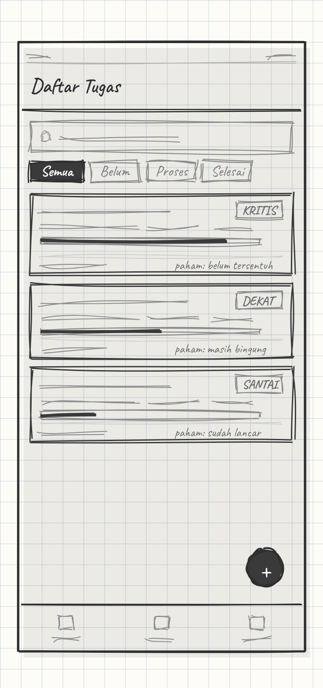
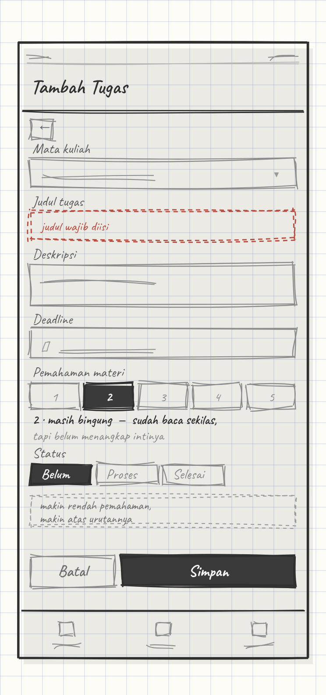
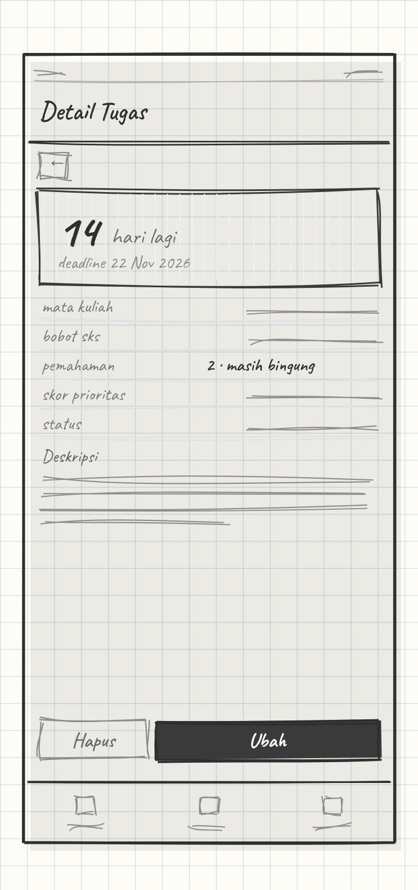
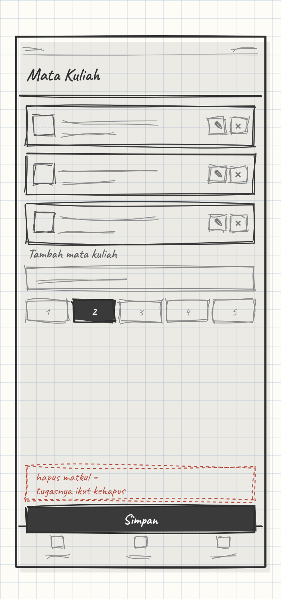

# Taskly (`task-tugas-akhir`)

Aplikasi mobile Flutter untuk memantau dan memprioritaskan tugas perkuliahan
berdasarkan bobot mata kuliah (SKS), tingkat pemahaman materi, dan sisa waktu menuju deadline.

> **Masalah yang diselesaikan:** Mahasiswa tidak kekurangan daftar tugas. Yang tidak ada
> adalah cara menentukan mana yang harus dikerjakan lebih dulu — karena deadline terdekat
> belum tentu yang paling penting.

Dibuat untuk memenuhi **Ujian Akhir Semester (UAS) Praktikum Mobile Programming (Kelompok 4)**.

---

## 👥 Tim Pengembang (Kelompok 4)

1. **Muhammad Nailul Ghufron Majid** (240605110160) — *Halaman Tulis, Validasi Form, & Operasi CRUD (Mata Kuliah & Form Tugas)*
2. **Mukti Baskara** (240605110182) — *Fondasi Sistem, Data Layer, REST API/Supabase, Model JSON & Routing*
3. **Fahmi Yusuf** (240605110072) — *Halaman Baca, TugasController & Logika Prioritas*

Detail pembagian tugas dapat dilihat pada [`jobdesk.md`](jobdesk.md).

---

## 💡 Masalah & Landasan Kebutuhan

Tugas dari beberapa mata kuliah datang hampir bersamaan dengan deadline yang berdekatan.
Aplikasi to-do list biasa hanya menampilkan daftar itu apa adanya, urut sesuai waktu
ditambahkan atau sesuai tanggal deadline. Akibatnya:

- **Deadline terdekat belum tentu yang paling penting.** Tugas ringan dari mata kuliah
  2 SKS bisa menutupi tugas berat dari mata kuliah 4 SKS yang sebenarnya lebih menentukan nilai.
- **Yang paling mendesak justru sering terlewat**, karena yang paling dekat tanggalnya
  belum tentu yang paling besar bobotnya.
- **Mahasiswa mengerjakan berdasarkan urutan yang terasa mendesak**, bukan yang terukur.
  Keputusan diambil pakai perasaan, bukan angka objektif.

### Sasaran Pengguna

| Aspek | Keterangan |
| --- | --- |
| **Siapa** | Mahasiswa aktif yang mengambil 5–8 mata kuliah per semester |
| **Kondisi** | Menerima tugas dari banyak mata kuliah dengan deadline berdekatan |
| **Kebiasaan sekarang** | Mencatat di buku, Google Tasks, atau grup WhatsApp — semuanya berupa daftar tanpa bobot |
| **Yang dibutuhkan** | Urutan pengerjaan yang bisa dipertanggungjawabkan, bukan sekadar daftar |
| **Kemampuan teknis** | Terbiasa aplikasi mobile sehari-hari, tidak perlu dipandu |

---

## 🧮 Solusi & Formula Prioritas Terukur

Aplikasi ini tidak sekadar menambah daftar tugas baru. Yang ditambahkan adalah **satu angka terukur yang menjawab "kerjakan yang mana dulu"**, dihitung dari tiga hal yang menentukan mendesak atau tidaknya sebuah tugas:

$$\text{skor} = \frac{\text{sks} \times (6 - \text{pemahaman})}{\text{sisa\_hari}}$$

| Masalah | Variabel Rumus | Akibatnya pada Daftar Tugas |
| --- | --- | --- |
| Deadline terdekat belum tentu paling penting | `sks` (bobot mata kuliah 1–6) | Tugas dari mata kuliah berbobot besar naik peringkat, tidak tenggelam oleh tugas ringan |
| Tugas berat justru yang belum dipahami | `pemahaman` (skala 1–5) | Tugas yang materinya belum dikuasai naik peringkat (makin rendah pemahaman, makin mendesak) |
| Yang mendesak sering terlewat | `sisa_hari` (pembagi) | Semakin dekat deadline, skor naik eksponensial. Sisa 1 hari mengalahkan sisa 14 hari |
| Urutan ditentukan perasaan | Diurutkan menurun berdasarkan skor | Urutan bisa dipertanggungjawabkan secara logis dan matematis |

### Jangkar Kognitif Pemahaman (Skala 1–5)

Tiap angka memiliki definisi tetap yang ditampilkan langsung di formulir aplikasi saat pengguna memilih tombol pemahaman:

| Nilai | Label Tombol | Arti Lengkap di Aplikasi |
| :---: | :--- | :--- |
| **1** | Belum tersentuh | Belum buka materi atau baca soalnya sama sekali |
| **2** | Masih bingung | Sudah baca sekilas, tapi belum menangkap intinya |
| **3** | Paham konsep | Mengerti teorinya, belum bisa mengerjakan sendiri |
| **4** | Bisa, perlu contekan | Bisa mengerjakan, masih perlu buka referensi |
| **5** | Sudah lancar | Bisa mengerjakan tanpa bantuan |

### Badge Urgensi Real-Time

Setiap tugas menampilkan lencana urgensi dinamis berbasis ambang batas:
* 🟥 **KRITIS** — Sisa hari $\le 1$ atau $\text{skor} \ge 6.0$ (Mengerjakan hal lain lebih dulu berisiko kehilangan nilai besar).
* 🟨 **DEKAT** — Sisa hari 2–3 hari atau $\text{skor} \ge 3.0$ (Perlu masuk rencana pengerjaan minggu ini).
* 🟩 **SANTAI** — Sisa hari aman dengan skor terkontrol (Masih aman, tetap dalam pemantauan).

---

## 🎨 Rancangan Antarmuka (Wireframe & Desain Neo-Brutalism)

Aplikasi mengadopsi estetika antarmuka **Neo-Brutalism** (`NeoCard`, border tebal kontras `2px`, solid offset shadow `Offset(3,3)`, dan palet warna energetik) yang mengadaptasi rancangan wireframe 4 halaman utama:

<table>
<tr>
<td width="300" valign="top"></td>
<td valign="top">

### 1. Daftar Tugas (`/` & `/tasks`)
Halaman utama yang langsung menjawab pertanyaan *"kerjain yang mana dulu?"*.
- Kartu tugas diurutkan menurun secara otomatis berdasarkan `skorPrioritas`.
- Tiap kartu memuat nama mata kuliah, bobot SKS, sisa hari, label pemahaman, dan badge urgensi (**KRITIS**, **DEKAT**, **SANTAI**).
- Tombol `+` membuka form penambahan tugas.

</td>
</tr>

<tr>
<td width="300" valign="top"></td>
<td valign="top">

### 2. Tambah / Ubah Tugas (`/form`)
Formulir ganda untuk membuat tugas baru maupun memperbarui tugas yang sudah ada.
- Mata kuliah dipilih dari *Dropdown* daftar mata kuliah tersimpan (agar bobot SKS terikat pasti).
- Pemilih tanggal deadline via *DatePicker*.
- Pemilih skala pemahaman interaktif dengan 5 tombol angka `[1] [2] [3] [4] [5]` disertai teks penjelasan dinamis.
- Validasi form ketat dan tombol hapus tugas (pada mode edit).

</td>
</tr>

<tr>
<td width="300" valign="top"></td>
<td valign="top">

### 3. Detail Tugas (`/detail`)
Dibuka saat kartu tugas diketuk.
- Angka besar *countdown* sisa hari menuju deadline.
- Rincian tabel: mata kuliah, bobot SKS, pemahaman materi, skor prioritas, deskripsi lengkap, dan status.
- Aksi ganti status pengerjaan cepat dan tombol edit/hapus.

</td>
</tr>

<tr>
<td width="300" valign="top"></td>
<td valign="top">

### 4. Kelola Mata Kuliah (`/mata-kuliah` atau Tab Matkul)
Halaman pengelola entitas bobot SKS sebagai pembilang rumus prioritas.
- Menampilkan daftar mata kuliah beserta bobot SKS (1–6) dan jumlah tugas terikat.
- Formulir popup tambah dan ubah mata kuliah.
- Fitur hapus mata kuliah dengan konfirmasi bahaya penghapusan berantai (*Cascade Delete*).

</td>
</tr>
</table>

---

## 🏛️ Struktur Arsitektur Berkas

```
lib/
├── core/
│   └── app_colors.dart         // Palet warna resmi Neo-Brutalism
├── models/
│   ├── mata_kuliah_model.dart  // Model entitas Mata Kuliah (id, nama, sks)
│   ├── pemahaman.dart          // Definisi skala 1-5, label, dan fungsi bobot
│   └── task_model.dart         // Model Tugas, getter skorPrioritas, dan urgensi
├── screens/
│   ├── main_shell.dart         // Navigasi bawah shell utama (Home, Tasks, Matkul, Stats, Profile)
│   ├── dashboard_screen.dart   // Ringkasan progres harian & tugas mendesak
│   ├── tasks_screen.dart       // Daftar tugas terurut prioritas
│   ├── add_task_screen.dart    // Form Tambah / Edit Tugas & selector 1-5
│   ├── mata_kuliah_screen.dart // Layar CRUD Mata Kuliah
│   ├── statistics_screen.dart  // Metrik penyelesaian tugas
│   └── profile_screen.dart     // Tampilan profil pengguna
└── widgets/
    ├── neo_card.dart           // Komponen kartu border hitam solid shadow
    └── task_tile.dart          // Item kartu tugas dengan badge urgensi dinamis
```

---

## 🚀 Menjalankan Aplikasi

1. **Pastikan Flutter SDK terpasang:**
   ```bash
   flutter --version
   ```
2. **Pasang seluruh dependensi:**
   ```bash
   flutter pub get
   ```
3. **Jalankan pengujian (Unit & Widget Test):**
   ```bash
   flutter test
   ```
4. **Jalankan aplikasi di perangkat / emulator:**
   ```bash
   flutter run
   ```
